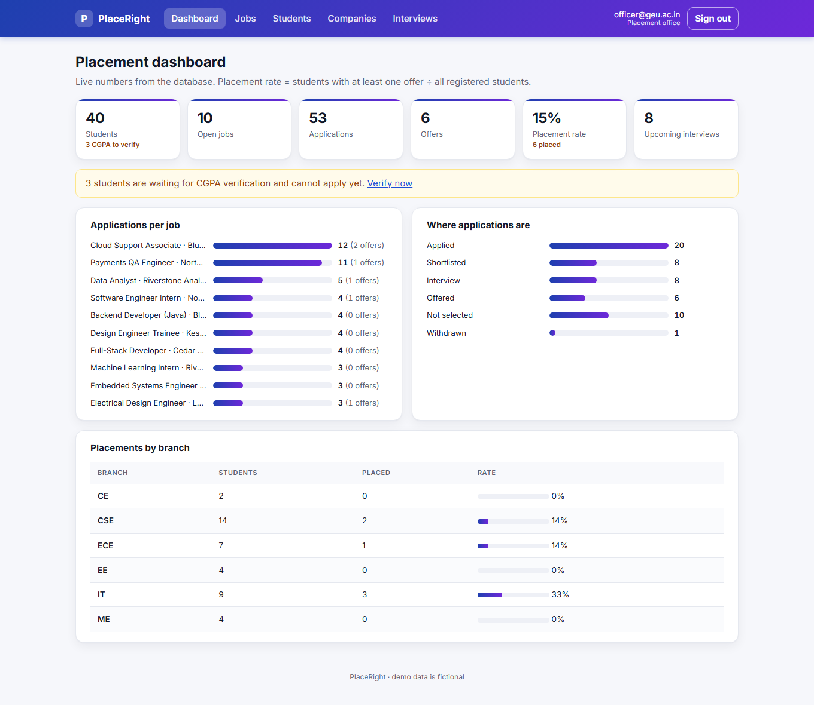
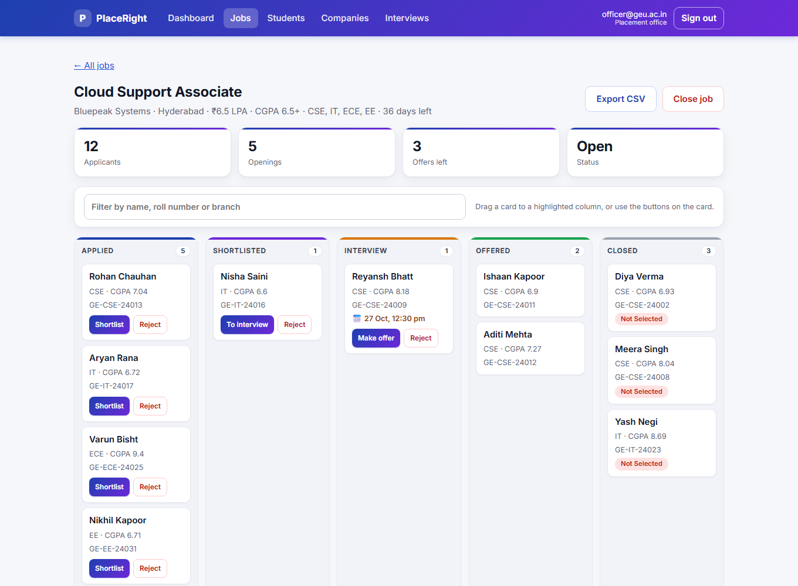
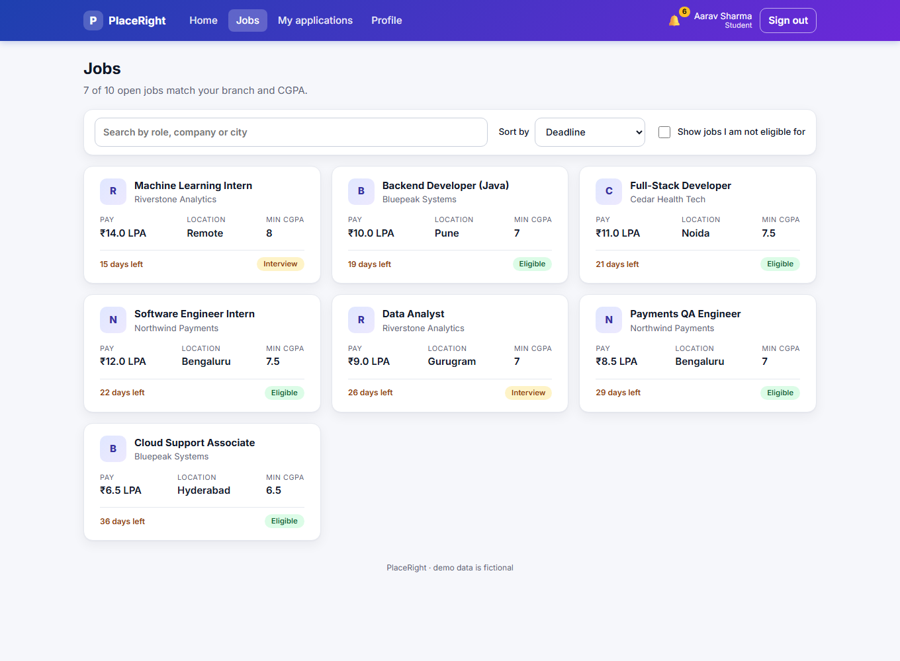
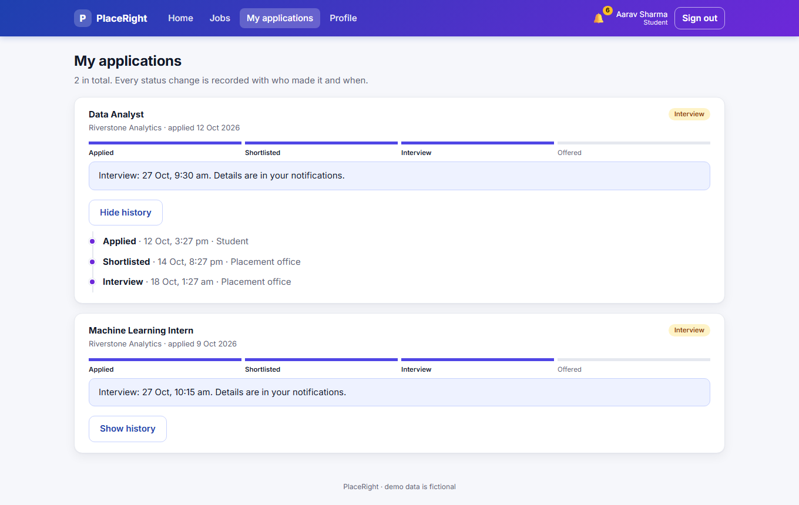
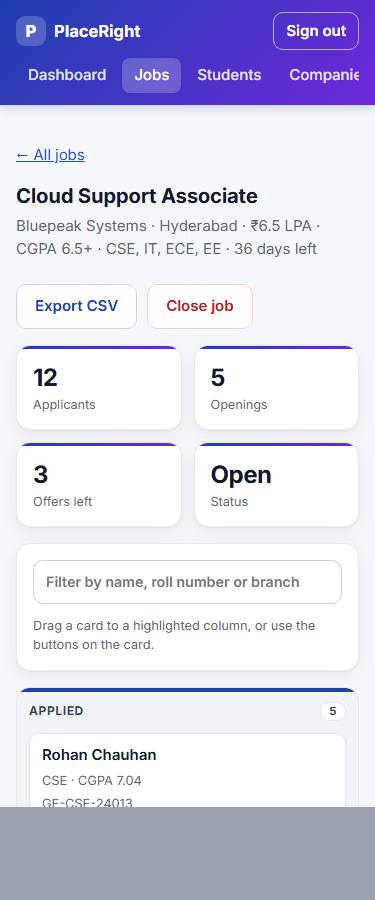
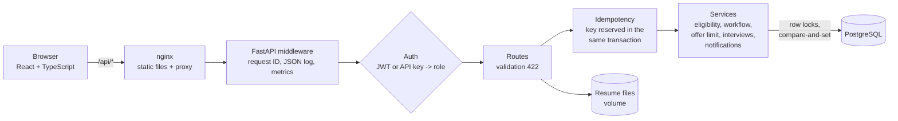
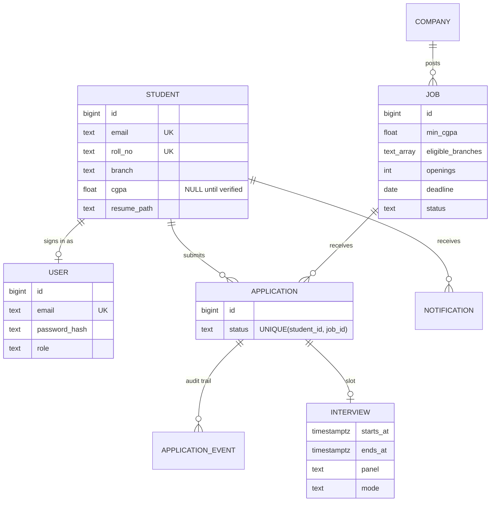
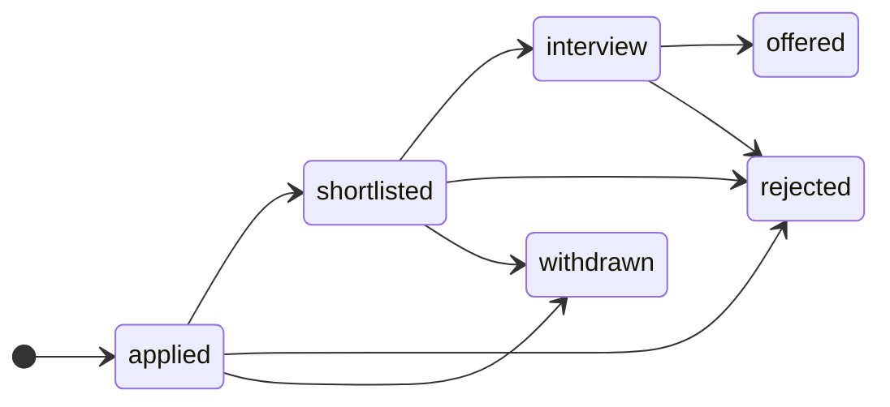

# PlaceRight: Campus Recruitment Portal

A full-stack placement portal for a college placement cell. Students sign up with their college email, see only
the jobs they are eligible for, apply in one click and follow every step of their application. The placement
office verifies CGPAs, posts jobs, moves applicants through a kanban pipeline, books interview slots without
clashes and exports applicant lists.

React + TypeScript · FastAPI · PostgreSQL (plain SQL, Alembic migrations) · JWT + bcrypt · Docker · GitHub Actions

**[Full documentation (PDF)](docs/Campus_Recruitment_API_Documentation.pdf)**

| Officer dashboard | Applicant pipeline |
|---|---|
|  |  |
| **Student: eligible jobs** | **Student: application timeline** |
|  |  |



## What it does

**Students**
- sign up with a `@geu.ac.in` email (password stored as a bcrypt hash); CGPA is entered by the placement office,
  never by the student
- see the jobs that match their branch and verified CGPA, with the reason when a job is not open to them
- apply once (retries are safe), track each application on a progress bar and a timeline of who changed what and when
- upload a resume (PDF, max 2 MB), get notifications when an application moves or an interview is booked

**Placement office**
- dashboard: students, open jobs, applications, offers, placement rate, upcoming interviews; applications per job,
  where applications are, placements by branch
- per-job kanban: only valid moves are offered (buttons or drag and drop), and the API enforces them again
- interview scheduling: a student cannot be in two interviews at once and a panel cannot interview two people at once
- CGPA verification, company and job management, CSV export of applicants

## Architecture



| Layer | Where | Knows about |
|---|---|---|
| Web app | `frontend/src` | pages, forms, API client (`api.ts`), auth state (`auth.tsx`) |
| HTTP | `backend/app/main.py` | routes, status codes, who may call what |
| Validation | `backend/app/schemas.py` | email, CGPA 0–10, branches, time zones, sizes |
| Business rules | `backend/app/services.py` | eligibility, workflow, offer limit, interview clashes, notifications |
| Data | `backend/app/repository.py` | SQL only |
| Cross-cutting | `security.py`, `idempotency.py`, `uploads.py`, `observability.py` | auth, retry safety, files, metrics |



## Run it

**Docker (everything):**

```bash
cp .env.example .env               # then change every value
docker compose up --build          # http://localhost:8080   (API docs: http://localhost:8080/api/docs)
docker compose exec backend python seed.py     # optional fictional demo data
```

**Without Docker (Windows friendly):**

```powershell
cd backend
python -m venv .venv; .venv\Scripts\activate
pip install -r requirements-dev.txt
python dev_db.py                   # starts a local Postgres (pgserver) and prints DATABASE_URL=...
$env:DATABASE_URL = "<printed url>"; $env:JWT_SECRET = "<32+ random characters>"
python seed.py                     # fictional demo data (logins below)
uvicorn app.main:app --port 8102   # API, docs at http://127.0.0.1:8102/docs

cd ../frontend
npm install
$env:VITE_DEMO = "1"; npm run dev  # http://localhost:5182 (forwards /api to :8102)
```

Demo logins (seeded, fictional): `officer@geu.ac.in` and e.g. `aarav.sharma@geu.ac.in`, password `placeright-demo`
(set `SEED_PASSWORD` before seeding anything public).

**Tests**

```bash
cd backend && python -m pytest -q      # 77 tests against a real Postgres (DATABASE_URL, or pgserver locally)
cd frontend && npm test                # 11 tests: flows, retries, workflow rules, axe accessibility checks
python scripts/walkthrough.py          # end-to-end story against a running API with an empty database
```

CI (`.github/workflows/ci.yml`) runs the backend tests against a Postgres service container, runs the seed script,
type-checks, tests and builds the web app, and builds both Docker images.

**Deploy:** `render.yaml` creates a Postgres database, the API and the static web app on Render (see the comments in
that file for free-tier limits).

## Rules the system enforces

| Rule | Response when broken |
|---|---|
| Valid input (college email for sign-up, CGPA 0–10, known branch, openings > 0, future deadline, time zone on interview times) | 422 |
| Unique email, roll number, company name; one application per student per job (database constraint) | 409 |
| Branch eligible, CGPA verified and at least the job's minimum | 403 |
| Students only see and change their own records, cannot set their CGPA, can only withdraw | 403 |
| Status moves only along the workflow below; no more offers than openings (the job closes itself when full) | 409 |
| No overlapping interviews for a student or for a panel | 409 |
| Resume: PDF bytes (not just the name), at most 2 MB | 415 / 413 |
| Five wrong passwords for one email within 15 minutes | 429 |



## How the tricky parts work

**The last opening.** Two reviewers click "Make offer" for the last opening at the same moment. `change_status`
locks the job row (`SELECT ... FOR UPDATE`) before reading anything, so the second request waits, then sees the first
offer and gets 409. The status update is also compare-and-set (`WHERE status = <what we read>`).
`test_concurrency.py` fires 8 parallel offers at a job with one opening and checks that exactly one wins.

**Retries.** `POST /applications` and `PATCH .../status` accept an `Idempotency-Key`. The key is *reserved* in the
same transaction as the action: if two first attempts with the same key arrive together, Postgres makes the second
one wait on the first one's uncommitted row, then it replays the stored response. If the first attempt fails, the
reservation rolls back with it, so a corrected retry works. The web app sends one key per click and reuses it if the
student retries after a network error. (The earlier SQLite version stored the key after the action and documented
that two simultaneous first attempts could both run; this closes that gap, and a test covers it.)

**Interview clashes.** Checking for an overlap and then inserting is a race: two officers could both see "free".
`schedule_interview` locks the student's row and takes a per-panel advisory lock (always in that order, so no
deadlocks) before checking and writing. A test books one panel for six students in parallel; exactly one succeeds.

**Accounts.** Sign-up creates the student and the login in one transaction. Passwords are bcrypt-hashed; an unknown
email is checked against a dummy hash so response times do not reveal which emails have accounts. Tokens are HS256
JWTs with a fixed algorithm list and an 8-hour expiry. API keys (for scripts) are stored as SHA-256 hashes and the
officer key is compared in constant time.

**Uploads.** The file type is checked from the first bytes (`%PDF-`), the size while reading, and the stored file
gets a random name, so `../../etc/passwd.pdf` cannot write outside the uploads folder.

**CSV export.** Cells starting with `=`, `+`, `-` or `@` are prefixed with `'` so a spreadsheet shows them as text
instead of running them as formulas ("CSV injection").

## Limitations and next steps

- The login token is kept in `sessionStorage`. That is simple, and it means any XSS on the page could read it.
  An HttpOnly cookie plus CSRF protection would be stronger.
- Login lockout and metrics are in memory, so they are per instance. With several instances they would move to Redis
  or the database, and metrics to Prometheus.
- No email verification or password reset yet, and no refresh tokens (users sign in again after 8 hours).
- Resumes are stored on a local volume. On Render's free tier they are lost on restart; object storage (S3) is the
  real fix.
- Notifications are in-app only (no email or push).
- The demo data is generated (`seed.py`) and fictional. There are no real usage numbers; the dashboard shows
  whatever is in the database.

## Things to be ready to explain

- Why `SELECT ... FOR UPDATE` on the job row, and why the job is locked before the application (lock order).
- Why the idempotency key is inserted *before* the action in the same transaction, and what Postgres does when two
  transactions insert the same primary key.
- Why a database `UNIQUE` constraint is still needed when the code checks for duplicates.
- 401 vs 403 vs 404 vs 409 vs 422, and when 413, 415 and 429 are used.
- What a JWT contains, why `algorithms=["HS256"]` is fixed, and why tokens expire.
- Why bcrypt and not SHA-256 for passwords, and why API keys can use SHA-256.
- How the web app knows which buttons to show (`/meta/workflow`), and why the API checks again anyway.
