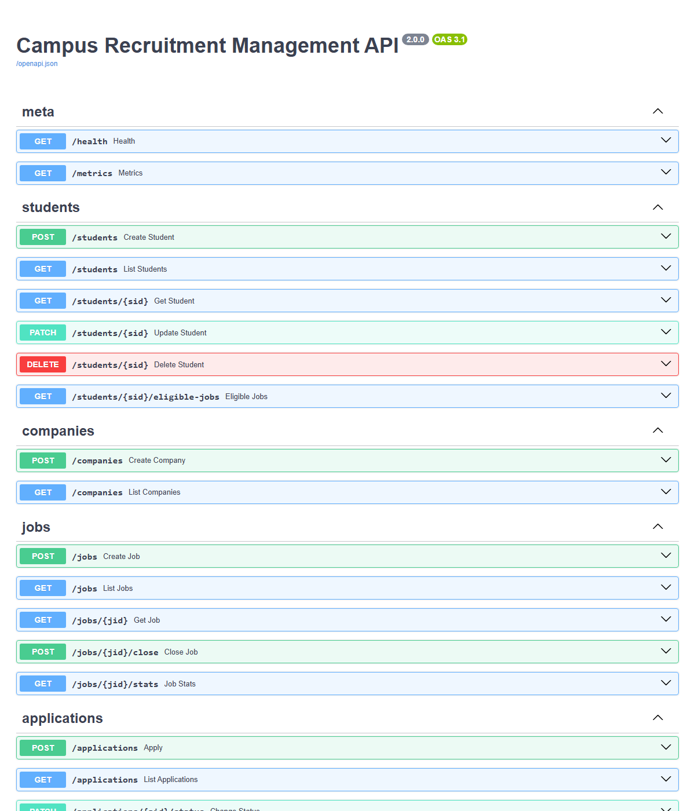
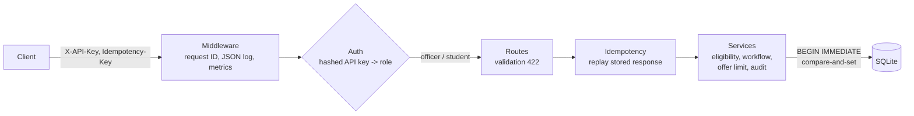
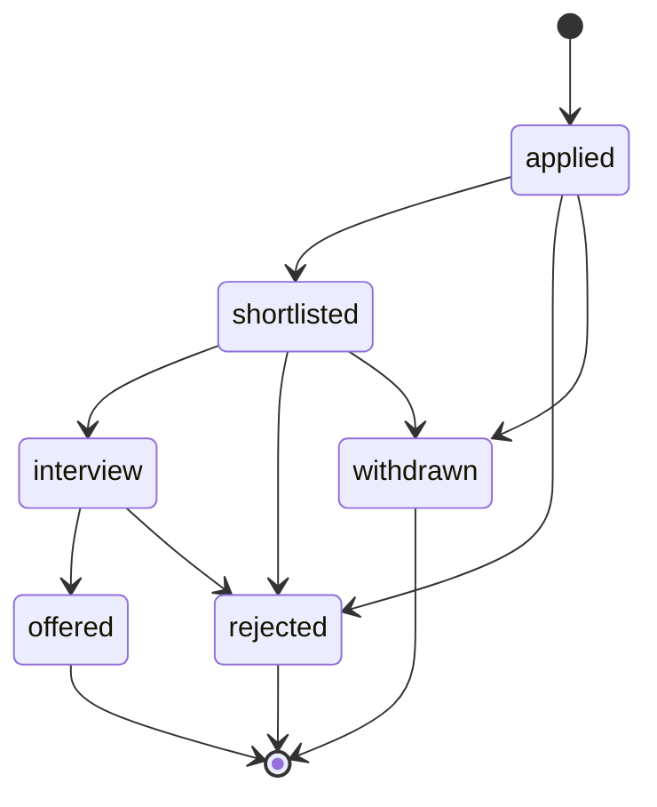

# Campus Recruitment Management API

REST API for a college placement cell: student profiles, companies, job postings and applications, with eligibility
rules, an application status workflow and automated tests.

Python · FastAPI · SQLite (plain SQL, no ORM) · Pydantic · pytest

**[Full documentation (PDF)](docs/Campus_Recruitment_API_Documentation.pdf)** · see it work end to end: `python scripts/walkthrough.py` against a fresh server (retries, eligibility, ownership, workflow and the race for the last opening)





**Deploy a live demo:** on [Render](https://render.com) choose *New + → Blueprint* and pick this repo; `render.yaml` does
the rest (it also generates the officer key). Then open `https://<your-service>.onrender.com/docs`.

## Run

```powershell
python -m venv .venv
.venv\Scripts\activate
pip install -r requirements.txt
$env:RECRUIT_ADMIN_KEY = "<a long random string>"   # the placement officer's API key (never commit it)
uvicorn app.main:app --reload          # interactive docs: http://127.0.0.1:8000/docs
python -m pytest -q                    # 48 tests
docker build -t recruitment-api . ; docker run -e RECRUIT_ADMIN_KEY=... -p 8000:8000 recruitment-api
```

Every request sends `X-API-Key`. The officer's key comes from `RECRUIT_ADMIN_KEY`; creating a student returns that
student's own key once. The database is a file (`recruitment.db`, or the path in `RECRUIT_DB`), created on first start.
CI (`.github/workflows/ci.yml`) runs the tests and builds the Docker image on every push and pull request.

## Endpoints

| Method | Path | What |
|---|---|---|
| POST / GET | `/students`, `/students/{id}` | Create, list (filter by branch, min CGPA, skill; paginated), get |
| PATCH / DELETE | `/students/{id}` | Partial update, delete (also deletes their applications) |
| GET | `/students/{id}/eligible-jobs` | Open jobs this student can apply to (branch, CGPA, deadline) |
| POST / GET | `/companies` | Create, list |
| POST / GET | `/jobs`, `/jobs/{id}` | Create, list (filter by status, company, branch; paginated), get |
| POST | `/jobs/{id}/close` | Stop accepting applications |
| GET | `/jobs/{id}/stats` | Applications by status, offers left |
| POST / GET | `/applications` | Apply, list (filter by job, student, status) |
| PATCH | `/applications/{id}/status` | Move through the workflow |
| GET | `/applications/{id}/history` | Audit trail: every status change, who made it, when |
| GET | `/metrics` | Requests, status codes and p50/p95 latency per route (officer only) |

## Security and reliability

| Concern | How it is handled |
|---|---|
| Authentication | `X-API-Key` on every request. Student keys are random, shown once, stored as SHA-256 hashes; the officer key is compared in constant time |
| Authorisation | Officer: everything. Student: own profile (not CGPA), own applications (apply, withdraw), job listings. Checked on every route and again in the service layer |
| Retries | `Idempotency-Key` on `POST /applications` and `PATCH .../status`: a retry returns the stored first response (`Idempotent-Replayed: true`) instead of acting twice; the same key with a different body is 422; failed requests are not stored, so a fixed retry works |
| Audit | `application_events` records from-status, to-status, actor (`officer` / `student:<id>`) and time for every change |
| Observability | `X-Request-ID` on every response (echoed if the client sent one), one JSON log line per request, `/metrics` grouped by route template |
| Delivery | Dockerfile (non-root user, database in a volume), GitHub Actions CI |

## Rules the API enforces

- **Validation (422):** email format, CGPA 0-10, known branch codes, roll number format, openings > 0, deadline not
  in the past, at least one eligible branch.
- **Uniqueness (409):** one student per email and per roll number, one company per name, one application per student
  per job (a database `UNIQUE` constraint, so it holds even under parallel requests).
- **Eligibility (403):** a student can apply only if their branch is eligible and their CGPA meets the minimum.
- **Workflow (409 on anything else):**



- **Offer limit:** a job never gets more offers than openings. When the last opening is filled the job closes itself.

## How it works

Three layers, each with one job:

| Layer | File | Knows about |
|---|---|---|
| HTTP | `app/main.py` | routes, status codes, request/response models |
| Business rules | `app/services.py` | eligibility, deadlines, workflow, offer limit |
| Data | `app/repository.py` | SQL only |

Validation lives in `app/schemas.py` (Pydantic), so bad input is rejected before any SQL runs.

**Race safety.** Two reviewers might click "offer" for the last opening at the same moment. `change_status` runs the
read, the "offers left?" check and the write inside one `BEGIN IMMEDIATE` transaction, which takes SQLite's write lock
first, so the second request sees the first one's offer and gets 409. The status update is also compare-and-set
(`WHERE status = <the status we read>`). `tests/test_concurrency.py` fires 8 parallel offers at a job with 1 opening and
checks that exactly one wins.

Writing that test found a real bug: FastAPI opened the database connection on one worker thread and ran the endpoint
on another, which SQLite refuses by default. The fix and the reason are in `app/db.py`.

## Things to be ready to explain

- Why a database constraint, not only a Python check, prevents duplicate applications.
- What `BEGIN IMMEDIATE` does and why a plain `BEGIN` would not be enough here.
- Why validation returns 422, a missing record 404, a broken rule 403 and a conflict 409.
- What changes for PostgreSQL: row locks (`SELECT ... FOR UPDATE`) instead of SQLite's single write lock.
- What an idempotency key protects against (a client retrying after a timeout) and why payment APIs require them.
- Why API keys are stored hashed, and why the comparison is constant-time.

## Not done yet (good next steps)

- Idempotency is checked before and stored after the action, outside one transaction: two *simultaneous* first
  attempts with the same key could both run (the database `UNIQUE` rule still stops a duplicate application).
  Fix: reserve the key in the same transaction as the action.
- Key rotation and expiry; per-key rate limiting.
- Database migrations (Alembic) instead of `CREATE TABLE IF NOT EXISTS`; PostgreSQL for several instances.
- Metrics to Prometheus instead of in-process counters.
